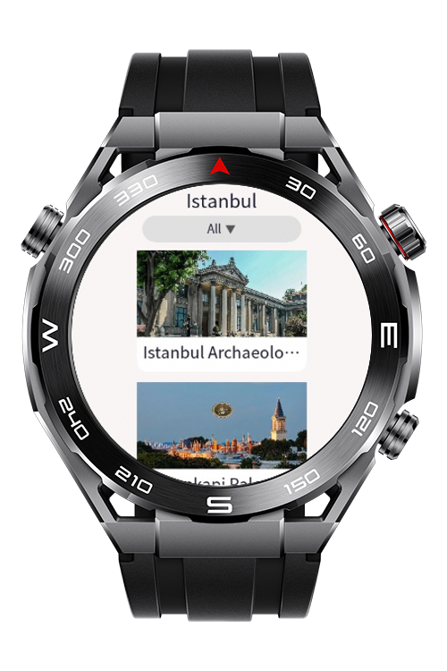
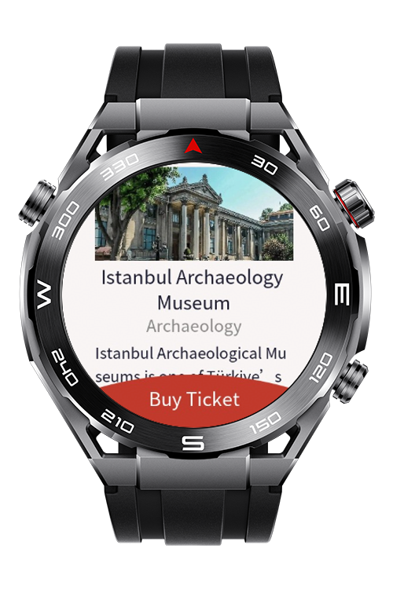
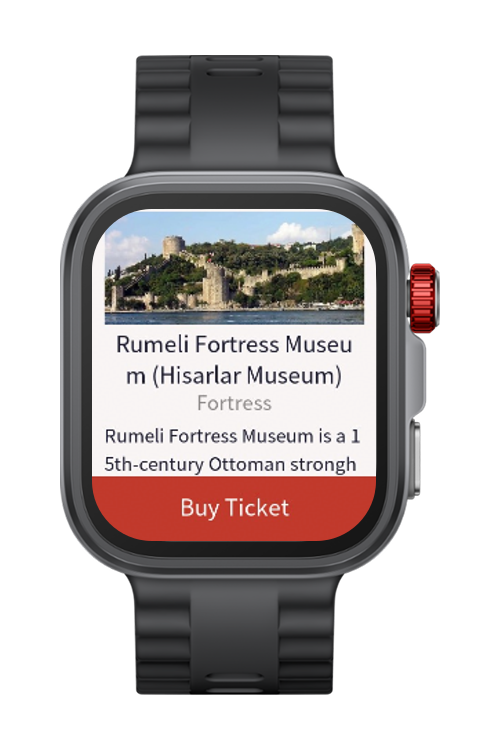
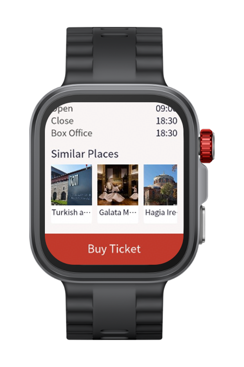

> **Note:** To access all shared projects, get information about environment setup, and view other guides, please visit [Explore-In-HMOS-Wearable Index](https://github.com/Explore-In-HMOS-Wearable/hmos-index).

# Istanbul Travel Lite  
View Istanbul's historical places, museums, points of interests from your watch.

# Preview

<div>
  
  
  
  
</div>

# Use Cases
- **See Places:** View museums, historical places, points of interests.
- **View Details:** See the details of places such as its history, location, open/close hours.
- **Tickets:** Buy tickets online via official link.

# Tech Stack

Languages: CSS, HML, JS
Frameworks: 6.0.1(21)
Tools: DevEco Studio Version 6.0.1.251
Libraries: @system.device, @system.file, @ohos.router

# Directory Structure
```
entry/src/main/
├── config.json
├── js/
│   └── MainAbility/
│       ├── app.js
│       ├── common/
│       │   ├── fileUtils.js            # File utilities
│       │   ├── fileUtilsInline.js      # In-line data for simulator
│       │   ├── fileUtilsRawfile.js     # Rawfile data for real devices
│       │   └── images/
│       │       └── places/             # Images for the places, matched by IDs.
│       └── pages/
│           ├── category/               # Category picker page
│           │   ├── category.css
│           │   ├── category.hml
│           │   └── category.js
│           ├── detail/                 # Place detail page
│           │   ├── detail.css
│           │   ├── detail.hml
│           │   └── detail.js
│           ├── index/                  # Home screen with places list
│           │   ├── index.css
│           │   ├── index.hml
│           │   └── index.js
│           └── qr/                     # QR screen that redirects to ticket webpage
│               ├── qr.css
│               ├── qr.hml
│               └── qr.js
└── resources/
    ├── base/
    │   ├── element/
    │   └── media/
    └── rawfile/
        └── places/                     # Places data in json format         
```

# Constraints and Restrictions
## Supported Devices
- Huawei Sport (Lite) Watch GT 4/5/6
- Huawei Sport (Lite) GT4/5 Pro
- Huawei Sport (Lite) Fit 3/4
- Huawei Sport (Lite) D2
- Huawei Sport (Lite) Ultimate

# LICENSE
**Istanbul Travel Lite** is distributed under the terms of the **MIT License**.
See the [LICENSE](/LICENSE) for more information.
